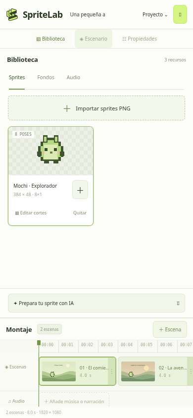
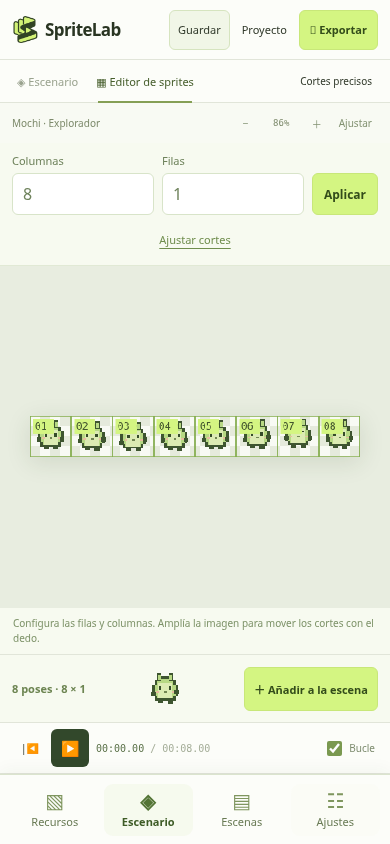
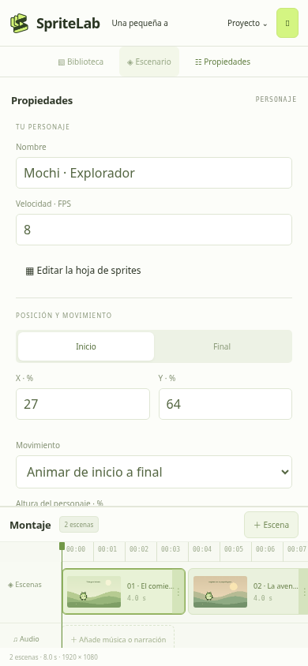
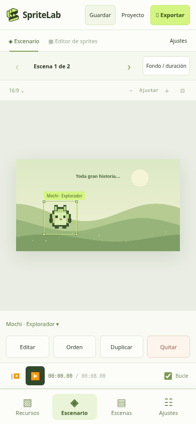
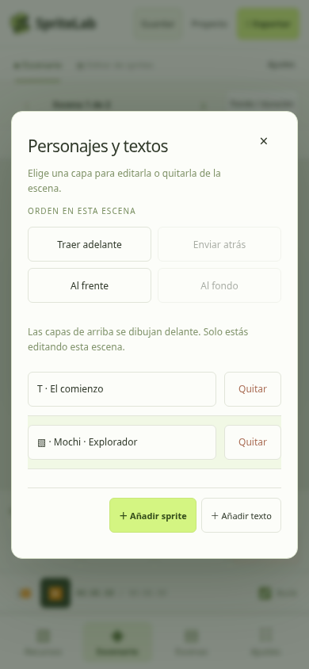
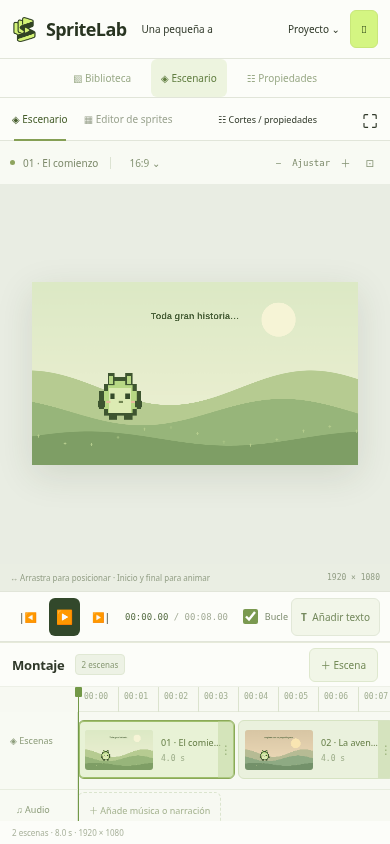
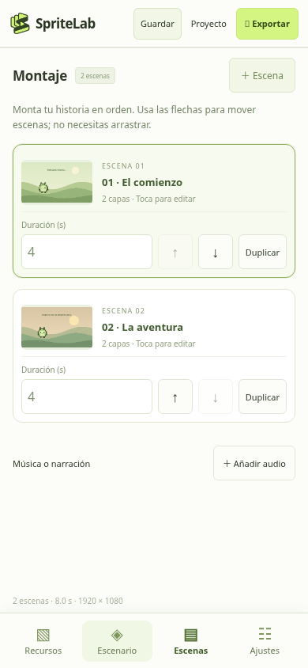

# Revisión del flujo móvil de SpriteLab

Objetivo: importar PNG, preparar la rejilla, componer personajes y montar escenas desde un teléfono, sin backend, login ni base de datos.

Las capturas pertenecen a esta revisión, con un proyecto de ejemplo y una vista de 390 × 844. Las pruebas adicionales usan emulación táctil a 360 × 800, 390 × 844 y 844 × 390. No sustituyen pruebas en teléfonos físicos ni una auditoría completa de accesibilidad.

## 1. Recursos y rejilla — simplificado

Antes, preparar el PNG requería alternar entre el editor y un panel de propiedades separado. La navegación y las acciones pequeñas dificultaban completar el flujo.

Ahora las filas y columnas se configuran encima de la hoja. Se mantienen el zoom, los cortes arrastrables, los campos de precisión y el selector de poses. La barra inferior separa Recursos, Escenario, Escenas y Ajustes. El contexto de la biblioteca muestra la escena a la que se añadirá el personaje.

Antes y después:

## 2. Seleccionar y quitar personajes — corregido y probado

El botón «Quitar» de la biblioteca eliminaba un recurso compartido y sus instancias en varias escenas. Además, el botón de quitar una capa estaba al final de un panel largo.

Ahora «Quitar de esta escena» elimina solo la instancia elegida, conserva el PNG y deja intactas las otras escenas. Si hay varias copias del mismo sprite, el editor pide elegir la copia. «Eliminar de la biblioteca» queda separado en Opciones del recurso y se bloquea mientras el recurso siga en uso.

Al seleccionar un personaje aparecen Editar, Orden, Duplicar y Quitar junto al escenario. También hay una lista de personajes para seleccionar capas pequeñas u ocultas detrás de otras. Una pulsación sin movimiento ya no añade una operación vacía al historial.

Antes y después:

La prueba de regresión compara la segunda escena antes y después de quitar y volver a añadir el mismo recurso en la primera. Confirma también que la biblioteca permanece intacta y que la eliminación global de un recurso en uso queda bloqueada.

## 3. Orden de capas — explícito y reversible

Traer adelante / Enviar atrás cambian una posición. Al frente / Al fondo mueven al extremo correspondiente. El orden cambia únicamente en la escena actual; las capas superiores de la lista se dibujan delante.

Las pruebas superponen dos sprites de colores y comprueban los píxeles del lienzo: al cambiar el orden, cambia el color visible. También comprueban Deshacer y Rehacer, y que otra escena siga idéntica.

## 4. Montaje de escenas — adaptado al tacto

La línea de tiempo horizontal y sus bordes pequeños se sustituyen, en móvil, por tarjetas con vista previa, duración editable, flechas de orden y duplicado. La línea de tiempo completa se conserva en escritorio. Guardar y Exportar mantienen texto visible, y la reproducción se pausa al cambiar de tarea.

Antes y después:

Se comprobó el recorrido táctil en vertical y horizontal, sin desbordamiento horizontal. En horizontal se compactan los controles de la biblioteca para que los botones de los recursos sigan accesibles.

## Verificación y límites

- `npm test`: sintaxis, rutas estáticas y ausencia de almacenamiento de proyectos en base de datos.
- `npm run test:browser`: edición, archivos de proyecto, exportación MP4/WebM con audio, cancelación, uso sin conexión y ausencia de peticiones externas.
- `npm run test:mobile`: aislamiento entre escenas, biblioteca protegida, orden visual real, historial, navegación táctil, rejilla, duración, montaje y formato vertical.
- Los controles principales tienen alternativas a arrastrar. Se ampliaron las zonas táctiles y se conservaron etiquetas accesibles y campos numéricos.
- No se afirma conformidad WCAG completa. No se probaron lectores de pantalla ni hardware iOS/Android físico. MP4 sigue dependiendo de los codificadores del navegador.
